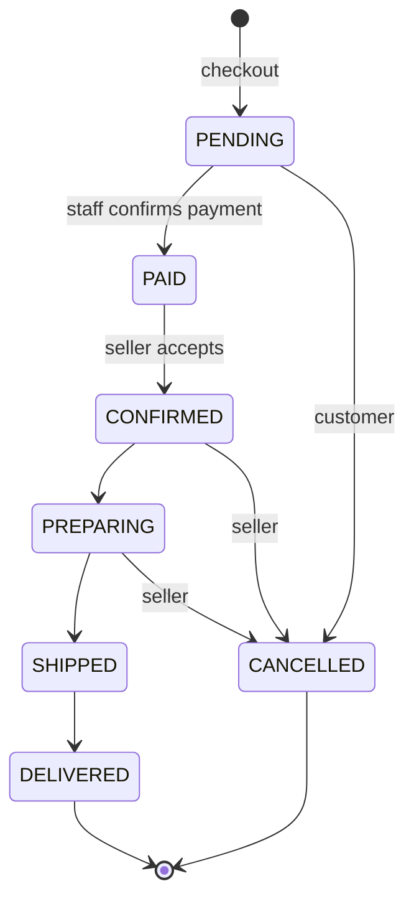

<div align="center">

# ECM — *Tu estilo, tu identidad*

**Full-stack fashion e-commerce platform: customer storefront and role-based back office.**


</div>

---

## Table of contents

- [Overview](#overview)
- [Architecture](#architecture)
- [Features](#features)
- [Tech stack](#tech-stack)
- [Repository structure](#repository-structure)
- [Quick start](#quick-start)
- [Getting started (step by step)](#getting-started-step-by-step)
- [Configuration](#configuration)
- [Troubleshooting](#troubleshooting)
- [Domain model](#domain-model)
- [Order lifecycle](#order-lifecycle)
- [API overview](#api-overview)
- [Security](#security)
- [Deployment](#deployment)
- [Roadmap](#roadmap)
- [Author](#author)

---

## Overview

ECM is a monorepo containing a complete e-commerce system for a fashion brand:

- **`backend/`** — a Spring Boot REST API (catalog, orders, payments, coupons, reviews, reports, email notifications).
- **`frontend/`** — an Angular 20 application with a customer storefront and a back office for sellers and admins.

The system supports the full purchase flow: browsing and filtering the catalog, checkout with Yape, Plin or bank transfer, manual payment verification by staff, order fulfillment tracking, and post-delivery reviews.

## Architecture


The backend follows a layered design: **Controller → Service → Repository**, with DTOs mapped by MapStruct so entities never leave the service layer.

## Features

### Storefront
- Catalog with server-side pagination, search, sorting, and filters (category, price range, size, color, discounts, collections).
- Product detail with image gallery, size and color selection, stock awareness, and reviews.
- Wishlist synchronized with the account.
- Cart and 3-step checkout (shipping address → payment → review) with coupon validation.
- Order history with a status tracker and cancellation while the order is still pending.

### Back office
- **Orders:** queue of paid orders, assignment to sellers, status transitions, and full status history.
- **Payments:** staff confirm or reject submitted payments.
- **Products, categories, collections, coupons, users:** full CRUD for admins.
- **Inventory:** low-stock and out-of-stock alerts.
- **Reports:** sales, inventory, and customers, with CSV export.

### Platform
- JWT authentication and three roles (`CLIENTE`, `VENDEDOR`, `ADMIN`); users can hold several roles.
- New accounts receive the `CLIENTE` role automatically on registration.
- Atomic checkout: stock validation, order, details, stock decrement, and payment are created in one transaction.
- Optimistic locking on product stock to prevent overselling under concurrent purchases.
- Stock and coupon usage are restored automatically when an order is cancelled.
- Transactional email notifications (sent after commit, asynchronously).

## Tech stack

| Layer | Technology |
|---|---|
| Backend | Java 21, Spring Boot 4, Spring MVC, Spring Data JPA (Hibernate 7), Spring Security 7 |
| Auth | JWT (JJWT 0.11) |
| Mapping & boilerplate | MapStruct 1.6, Lombok |
| Database | PostgreSQL 14+ |
| API docs | springdoc OpenAPI 3 (Swagger UI) |
| Email | Spring Mail (SMTP) |
| Frontend | Angular 20 (standalone components, signals), TypeScript 5.8, SSR, Reactive Forms |
| Build | Maven (wrapper included), npm |

## Repository structure

```
.
├── backend/                       # Spring Boot API
│   ├── src/main/java/com/example/ecm/
│   │   ├── config/                # Security, CORS, web, async, Swagger, DataSeeder
│   │   ├── controller/            # REST controllers
│   │   ├── service/               # Business logic (interfaces + impl)
│   │   ├── repository/            # Spring Data repositories and specifications
│   │   ├── model/                 # JPA entities and enums
│   │   ├── DTO/                   # Request and response DTOs
│   │   ├── mapper/                # MapStruct mappers
│   │   ├── security/              # JWT filter and service, UserDetails
│   │   ├── event/                 # Domain events (order emails)
│   │   └── exception/             # Global exception handling
│   ├── src/main/resources/        # application.properties + dev / prod profiles
│   ├── .env.example               # Template for local environment variables
│   ├── uploads/                   # Product images (created at runtime, git-ignored)
│   └── pom.xml
├── frontend/                      # Angular application
│   ├── src/app/core/              # Models, services, config, constants
│   ├── src/app/environments/      # API base URL (dev / prod)
│   ├── src/app/features/          # Home, catalog, checkout, profile, admin
│   └── src/app/shared/            # Shared components
└── README.md
```

## Quick start

For people who already have Java 21, Node 20.19+ and PostgreSQL running:

```bash
git clone https://github.com/DavidDevlo/ECM_ecomerce_monolito.git
cd ECM_ecomerce_monolito

# 1. Database
psql -U postgres -c "CREATE DATABASE ecm_db;"

# 2. Backend (terminal 1)
cd backend
cp .env.example .env          # edit DB_PASSWORD, JWT_SECRET and ADMIN_PASSWORD
chmod +x mvnw                 # Linux / macOS only
./mvnw spring-boot:run        # Windows: mvnw.cmd spring-boot:run

# 3. Frontend (terminal 2)
cd frontend
npm ci
npm start
```

Open `http://localhost:4200` and sign in with the admin credentials you set in `.env`.

## Getting started (step by step)

### Prerequisites

| Tool | Version | Check with |
|---|---|---|
| Java (JDK) | **21** or newer | `java -version` |
| Node.js | **20.19+**, 22.12+ or 24+ (required by Angular 20) | `node -v` |
| npm | 10+ | `npm -v` |
| PostgreSQL | 14+ | `psql --version` |
| Git | any | `git --version` |

Maven does not need to be installed; the project includes the Maven wrapper (`mvnw` / `mvnw.cmd`), which downloads Maven on first use.

### 1. Clone

```bash
git clone https://github.com/DavidDevlo/ECM_ecomerce_monolito.git
cd ECM_ecomerce_monolito
```

### 2. Create the database

The `dev` profile connects to **`jdbc:postgresql://localhost:5432/ecm_db`** by default. Create an empty database with that name:

```bash
psql -U postgres -c "CREATE DATABASE ecm_db;"
```

Or create it from pgAdmin. Tables are created automatically by Hibernate on first startup (`ddl-auto=update`). To use another host, port or database name, set `DB_URL`.

### 3. Configure the backend

```bash
cd backend
cp .env.example .env        # Windows PowerShell: Copy-Item .env.example .env
```

Edit `backend/.env` and set at least:

| Variable | Example | Notes |
|---|---|---|
| `DB_USERNAME` | `postgres` | Your PostgreSQL user. |
| `DB_PASSWORD` | `your_password` | Your PostgreSQL password. |
| `JWT_SECRET` | output of `openssl rand -base64 64` | **At least 32 characters**; shorter values make startup or login fail. |
| `ADMIN_PASSWORD` | `Admin123!` | Password of the initial admin user. |

The backend loads `backend/.env` automatically (`spring.config.import` in `application.properties`) **when it is started from the `backend/` directory**. Real environment variables always take precedence over the file, so you can also set them in your shell or in IntelliJ (*Run → Edit Configurations → Environment variables*) instead of using `.env`.

### 4. Run the backend

```bash
# Linux / macOS / Git Bash
chmod +x mvnw
./mvnw spring-boot:run

# Windows (CMD or PowerShell)
mvnw.cmd spring-boot:run
```

The `dev` profile is active by default. The API starts at `http://localhost:8080`.

On every startup, `DataSeeder`:

1. Creates the roles `CLIENTE`, `VENDEDOR` and `ADMIN` if they do not exist.
2. Creates the admin user (`ADMIN_USERNAME`, default `admin`) with the `ADMIN` and `CLIENTE` roles, **only if `ADMIN_PASSWORD` is set** and that user does not exist yet.

You should see `Seeder: usuario administrador 'admin' creado` in the log on first run.

> Run the backend **from the `backend/` directory**: both `.env` and `app.upload.dir=uploads` are relative paths, so images are stored in `backend/uploads/`.

### 5. Run the frontend

In a second terminal:

```bash
cd frontend
npm ci          # installs the exact versions from package-lock.json
npm start       # ng serve
```

Open `http://localhost:4200`.

In development the frontend calls the API directly at the URL defined in `frontend/src/app/environments/environment.ts` (`http://localhost:8080`). This works because the backend allows the origin in `CORS_ALLOWED_ORIGINS` (default `http://localhost:4200`).

### 6. Sign in

- **Admin:** use `ADMIN_USERNAME` / `ADMIN_PASSWORD` from your `.env`. Admins can assign the `VENDEDOR` role to other users from the back office.
- **Customer:** register from the UI; new accounts get the `CLIENTE` role automatically.

### 7. API documentation

With the backend running, Swagger UI is available at `http://localhost:8080/swagger-ui/index.html`.

## Configuration

### Environment variables

Secrets are never stored in the repository; every credential is read from the environment (or from the git-ignored `backend/.env`).

| Variable | Required | Default | Description |
|---|---|---|---|
| `DB_URL` | Prod | `jdbc:postgresql://localhost:5432/ecm_db` (dev) | JDBC URL of the database. Required in `prod`. |
| `DB_USERNAME` | Yes | — | PostgreSQL user. |
| `DB_PASSWORD` | Yes | — | PostgreSQL password. |
| `JWT_SECRET` | Yes | — | JWT signing key, at least 32 characters. Use a different random value per environment. |
| `ADMIN_PASSWORD` | First run | — | Password of the bootstrap admin. If empty, no admin is created. |
| `ADMIN_USERNAME` | No | `admin` | Bootstrap admin username. |
| `ADMIN_EMAIL` | No | `admin@ecm.com` | Bootstrap admin email. |
| `CORS_ALLOWED_ORIGINS` | Prod | `http://localhost:4200` | Comma-separated list of allowed frontend origins. |
| `UPLOAD_DIR` | No | `/home/ec2-user/uploads` (prod) | Image directory in `prod`. In `dev` it is always `backend/uploads`. |
| `MAIL_ENABLED` | No | `false` | `true` to send order emails. |
| `MAIL_USERNAME` / `MAIL_PASSWORD` | If mail enabled | — | SMTP credentials (for Gmail, use an app password). |

Generate a JWT secret:

```bash
# Git Bash / Linux / macOS
openssl rand -base64 64
```

```powershell
# Windows PowerShell
$b = New-Object byte[] 64
[System.Security.Cryptography.RandomNumberGenerator]::Create().GetBytes($b)
[Convert]::ToBase64String($b)
```

> Changing `JWT_SECRET` invalidates all issued tokens; users must sign in again.

### Frontend API URL

| File | Used by | Value |
|---|---|---|
| `frontend/src/app/environments/environment.ts` | `npm start` (development) | `http://localhost:8080` |
| `frontend/src/app/environments/environment.prod.ts` | `npm run build` (production) | Public backend origin |

Set `apiUrl` to the backend origin **without** a trailing `/api`; the services append `/api/...` themselves.

### Business settings

| Property | Default | Description |
|---|---|---|
| `app.shipping.free-threshold` | `299` | Subtotal from which shipping is free. |
| `app.shipping.flat-rate` | `15` | Flat shipping cost below the threshold. |
| `app.inventory.low-stock-threshold` | `5` | Stock level considered "low". |
| `app.upload.dir` | `uploads` | Directory for uploaded product images. |
| `jwt.expiration-ms` | `3600000` | Token lifetime (1 hour). |

### Profiles

| Profile | Purpose | How to activate |
|---|---|---|
| `dev` | Local development (default). | Nothing to do. |
| `prod` | Production; all secrets come from the environment. | `--spring.profiles.active=prod` or `SPRING_PROFILES_ACTIVE=prod` |

## Troubleshooting

| Symptom | Cause and fix |
|---|---|
| `./mvnw: Permission denied` | Run `chmod +x mvnw`, or use `sh mvnw spring-boot:run`. |
| `/bin/sh^M: bad interpreter` | `mvnw` was checked out with Windows line endings. Run `git config core.autocrlf input`, delete the folder and clone again, or run `dos2unix mvnw`. |
| `invalid target release: 21` | Your JDK is older than 21. Install JDK 21 and check `JAVA_HOME`. |
| `Could not resolve placeholder 'DB_USERNAME'` (or `JWT_SECRET`) | The variable is missing. Check `backend/.env` and that you started the backend from `backend/`. |
| `FATAL: database "ecm_db" does not exist` | Create the database (step 2) or point `DB_URL` to an existing one. |
| `WeakKeyException` / login returns 500 | `JWT_SECRET` is shorter than 32 characters. |
| `The Angular CLI requires a minimum Node.js version` | Upgrade Node to 20.19+ or 22.12+. |
| Browser shows CORS errors | Add the frontend origin to `CORS_ALLOWED_ORIGINS` and restart the backend. |
| Cannot sign in as admin | `ADMIN_PASSWORD` was empty on first run. Set it and restart; the seeder creates the admin if it does not exist. |

## Domain model

| Area | Entities |
|---|---|
| Identity | `User`, `Profile`, `Role`, `UserRole` |
| Catalog | `Category`, `Product`, `ProductImage`, `Collection` |
| Sales | `Order`, `OrderDetail`, `OrderStatusHistory`, `Payment`, `Coupon`, `ShippingAddress` (embeddable) |
| Engagement | `Review`, `WishlistItem`, `NewsletterSubscriber` |

Enums: `OrderStatus`, `PaymentMethod` (`YAPE`, `PLIN`, `TRANSFER`), `PaymentStatus` (`PENDING`, `PAID`, `REJECTED`), `DiscountType` (`PERCENT`, `FIXED`).

## Order lifecycle



- Admins can cancel from any non-final state.
- Cancelling restores stock, releases the coupon, and rejects pending payments.
- Every transition is stored in `order_status_history` (who, when, from and to).
- Reviews are only allowed for products from a `DELIVERED` order.

## API overview

Full interactive documentation is available in Swagger UI. Main groups:

| Domain | Endpoints | Access |
|---|---|---|
| Auth | `POST /api/auth/login` | Public |
| Registration | `POST /api/users` | Public |
| Catalog | `GET /api/products`, `/api/products/filters`, `/api/categories`, `/api/collections` | Public |
| Product admin | `POST/PUT/DELETE /api/products`, image upload and gallery | Admin |
| Orders | `POST /api/orders/checkout`, `GET /api/orders/me`, `GET /api/orders/{id}/history` | Customer |
| Order fulfillment | `GET /api/orders/available`, `POST /api/orders/{id}/accept`, `PATCH /api/orders/{id}/status` | Seller, Admin |
| Payments | `POST /api/payments/order/{id}`, `PATCH /api/payments/{id}/reference` | Customer |
| Payment review | `GET /api/payments/pending`, `POST /api/payments/{id}/confirm\|reject` | Seller, Admin |
| Coupons | `GET /api/coupons/validate`, CRUD under `/api/coupons` | Customer / Admin |
| Reviews | `POST /api/reviews`, `GET /api/reviews/product/{id}` | Customer / Public |
| Wishlist | `GET/POST/DELETE /api/wishlist` | Customer |
| Profile | `GET/PUT /api/profiles/me` | Authenticated |
| Roles | `/api/roles`, `/api/user-roles` | Admin |
| Shipping | `GET /api/shipping/config` | Public |
| Reports | `GET /api/admin/reports/{sales\|inventory\|customers\|low-stock}`, plus `/csv` variants | Admin |

### Catalog query parameters

`GET /api/products?search=&categoryId=&collectionId=&onlyWithDiscount=&minPrice=&maxPrice=&productSize=&color=&sortBy=price|name|createdAt&direction=asc|desc&page=0&pageSize=12`

The garment size filter is sent as `size` or `productSize`. Pagination uses **`pageSize`**; `size` is reserved for garment size.

### Checkout request

```json
{
  "shippingAddress": { "fullName": "", "phone": "", "address": "", "district": "", "reference": "" },
  "paymentMethod": "YAPE",
  "paymentReference": "optional",
  "couponCode": "optional",
  "items": [{ "productId": 1, "quantity": 2, "color": "Negro", "size": "M" }]
}
```

The user is taken from the JWT, never from the request body. Prices, discounts, shipping, and totals are computed by the server.

## Security

- Stateless authentication with JWT; method-level authorization with `@PreAuthorize`.
- Roles are checked per request and only active role assignments grant authorities.
- Ownership checks: customers can only read their own orders and payments.
- No secrets in version control; all credentials come from environment variables or the git-ignored `.env`.
- Single CORS configuration, driven by `CORS_ALLOWED_ORIGINS`.
- Consistent error responses through a global exception handler (400, 401, 403, 404, 409, 500).

## Deployment

The backend is deployed on AWS. In production:

1. Provision PostgreSQL (for example, Amazon RDS) and create the database.
2. Define the environment variables in the service that runs the app: `DB_URL`, `DB_USERNAME`, `DB_PASSWORD`, `JWT_SECRET`, `CORS_ALLOWED_ORIGINS`, `ADMIN_PASSWORD` (first run) and optionally `UPLOAD_DIR`.
3. Build and run:

   ```bash
   cd backend
   ./mvnw -DskipTests package
   java -jar target/*.jar --spring.profiles.active=prod
   ```

4. Set `apiUrl` in `frontend/src/app/environments/environment.prod.ts` to the public backend origin (without `/api`), then build with `npm run build`. The SSR server can be started with `npm run serve:ssr:ecm-frontend`.
5. Set `CORS_ALLOWED_ORIGINS` to the public frontend origin.
6. Serve both over HTTPS; a frontend on HTTPS cannot call an HTTP backend (mixed content).

Product images are stored on local disk (`UPLOAD_DIR`); use a persistent volume or object storage in production.

If you add a value to an enum that already has a column with a `CHECK` constraint, `ddl-auto=update` will not update that constraint; adjust it with SQL or adopt a migration tool.

## Roadmap

- [ ] Stock per size/variant (`ProductVariant`)
- [ ] HTML email templates
- [ ] Multiple saved shipping addresses
- [ ] Payment proof image upload
- [ ] Product Q&A, search autocomplete, back-in-stock alerts
- [ ] Card payments through a payment gateway
- [ ] Database migrations with Flyway
- [ ] `@EntityGraph` tuning for paginated queries
- [ ] Docker Compose for one-command local setup
- [ ] Automated tests and CI pipeline

## Author

**NAIRA ALTURE EDGAR DAVID** — Systems Engineering, Universidad Peruana Unión (UPeU).

## License

Developed for academic purposes. Add a license file if you plan to distribute it.
